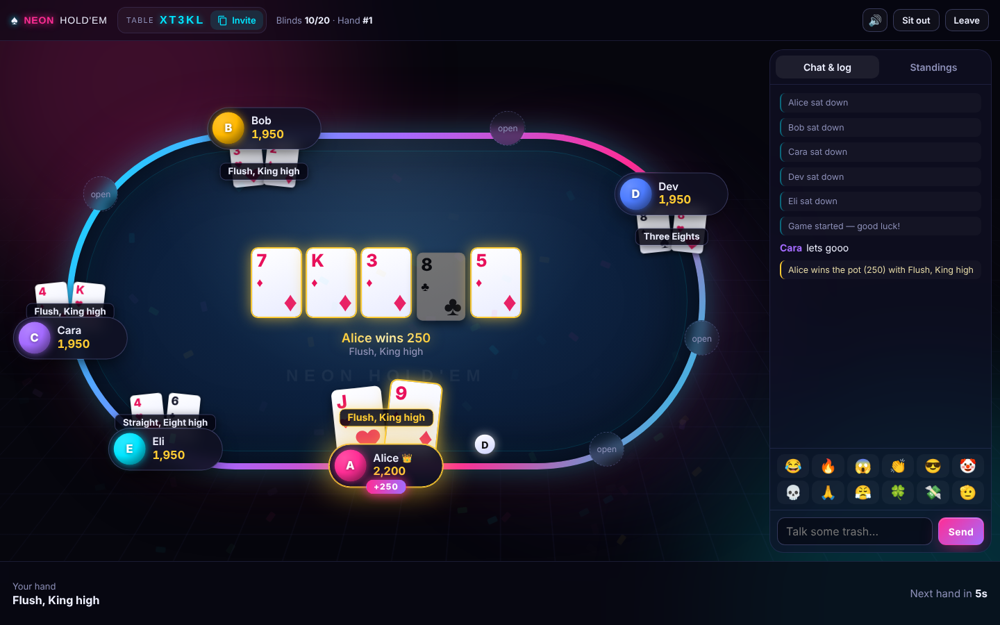

# 🎲 Game Night

Private, real-time games for you and your friends in the browser. There are no accounts: create a room and share the invite link.

| Game | Players | Where |
|---|---|---|
| ♠ **Neon Hold'em**: no-limit Texas Hold'em with play chips | 2–9 | `/poker/` |
| 🏝️ **Catan**: the full base game and the 5–6 player extension | 2–4 or 5–6 | `/catan/` |
| 🃏 **UNO Show 'Em No Mercy**: the 168-card brutal edition | 2–10 | `/uno/` |
| 🌀 **UNO Spin**: classic UNO plus the Spin wheel, with the classic or new wheel | 2–10 | `/spin/` |
| ♠ **Spades**: the partnership trick-taking classic, with computer players for empty seats | 4 (bots fill in) | `/spades/` |
| 🎲 **Yahtzee**: five dice, three rolls, thirteen boxes — solo, with friends or against bots | 1–8 | `/yahtzee/` |

One Node server runs all six games. The home page at `/` lets you pick a game. Each game has its own rooms, so room codes never mix between games. Invite links from before the merge (`/?room=CODE`) still open the poker table.

## Run it on your computer

You need [Node.js](https://nodejs.org) 18 or newer.

```bash
npm install
npm start
```

Open http://localhost:3000. Friends on the same Wi-Fi can join at `http://<your-computer's-local-IP>:3000`.

**Over the internet, without deploying:** keep `npm start` running and open a free tunnel in another terminal, for example `cloudflared tunnel --url http://localhost:3000`. It prints a public `https://….trycloudflare.com` link to share.

## Deploy it (free)

The repo includes a `render.yaml` blueprint. On [Render](https://render.com), choose **New → Blueprint** and pick this repo. WebSockets work on the free plan. Any other Node host with WebSockets works too: the start command is `npm start`, and the server reads the `PORT` environment variable.

On free plans the server goes to sleep when nobody is using it, so the first visit can take up to a minute. Rooms live in the server's memory, so a restart ends any game in progress.

---

## ♠ Neon Hold'em



- **Real poker rules.** Blinds and heads-up blind rules, minimum-raise enforcement, short all-ins that don't reopen betting, side pots, split pots with odd-chip handling, and all-in run-outs with cards shown.
- **Secure dealing.** The server shuffles with a cryptographic RNG and each player receives only their own hole cards.
- **Turn timer.** 15s, 30s, 60s or off. When time runs out the player auto-checks, or auto-folds if there's a bet. Two timeouts in a row sit that player out.
- **Table chat, emoji reactions** that float over a player's seat, and a hand log.
- **Sound and animation.** Synthesised sound effects, cards flying from the deck, chips sliding to the pot, glowing winning cards and confetti.
- **Live hand strength**, a **standings tab** with buy-ins and net results, and rebuys for busted players.
- **Reconnects** to the same seat after a refresh. Works on phones, with keyboard shortcuts on desktop: **F** fold, **C** check/call, **R** raise.

How a game works: one person creates a table and chooses the blinds, starting stack and turn timer. They become the host 👑. Once at least 2 players are seated, the host clicks **Start game** and hands deal automatically. **Sit out** skips hands without losing your seat. An empty table is removed after 30 minutes.

## 🏝️ Catan

The server enforces the official rules:

- **Board.** A random board every game: 19 hexes and 9 harbors on the base board, or 30 hexes, 2 deserts and 11 harbors on the 5–6 player board. 6s and 8s never touch.
- **Setup.** Snake order with the distance rule. Each road must touch the settlement just placed, and the second settlement pays out its starting resources.
- **Production.** Cities collect double, and the robber blocks its hex. The official bank-shortage rule applies.
- **Rolling a 7.** Players over the discard limit discard half, then the robber moves and steals.
- **Development cards.** One per turn, playable before rolling but never on the turn you bought it. Victory point cards stay hidden until the end.
- **Longest Road and Largest Army.** Opponents' settlements can break a road, and ties are handled the official way.
- **Trading.** 4:1 with the bank, or 3:1 and 2:1 at harbors. Player trades happen only with the active player, other players can make counter-offers, and gifts aren't allowed.
- **5–6 players.** A Special Building Phase after every turn.
- **Winning.** You can only win on your own turn.

The host can set the points to win (8–14), a turn timer (off, or 1–5 minutes, with automatic moves when time runs out), the discard limit, and whether the bank's card counts are hidden. The board uses hand-drawn SVG art and animations, and the game works on phones.

## 🃏 UNO No Mercy

The server enforces the official No Mercy rules:

- **Deck.** 168 cards: numbers, Skip, Reverse, Draw 2, Draw 4, Skip Everyone and Discard All in four colors, plus Wild Reverse Draw 4, Wild Draw 6, Wild Draw 10 and Wild Color Roulette.
- **Stacking.** On a draw card you can stack any draw card of equal or higher value (+2 → +4 → +6 → +10). Whoever can't stack takes the whole pile and loses their turn.
- **Can't play?** Draw until you can, then play that card or pass.
- **Action cards.** Skip Everyone lets you go again. Discard All also discards every other card of that color in your hand. With Color Roulette, the next player names a color and flips cards until it comes up, keeping every card they flip.
- **7–0 rule** (the host can turn it off). A 7 swaps hands with a player you choose; a 0 passes every hand to the next player.
- **Mercy rule.** Anyone holding 25 or more cards is knocked out of the round.
- **UNO!** Call it when you're down to one card. Until the next player moves, anyone can catch you for +2.
- **Winning.** Empty your hand, or be the last player standing. Wins are tallied across rounds, and players can join between rounds.

The host can set a turn timer (off, 15–60 seconds). When time runs out, the game takes the penalty or draws and plays for you. Each player receives only their own hand, and the draw pile stays hidden.

## 🌀 UNO Spin

Classic UNO: match color, number or symbol, or draw one card when you can't or won't play. Draw Two makes the next player draw 2 and lose their turn. Wild Draw Four uses the challenge rule: a successful challenge makes the player draw 4, and a failed one makes the challenger draw 6. You call UNO at one card, and the round winner scores the cards left in the other hands. The deck has 112 cards, including 20 Spin cards numbered 1–5 and 4 Wild Spin cards. Playing a Spin card triggers the wheel. The host picks which wheel to use:

- **Classic wheel (2005).** The *next* player spins instead of taking their turn.
  - **Almost UNO:** discard down to 2 cards.
  - **Discard Number** and **Discard Color:** discard any number of cards that share one number, or one color.
  - **Draw Red** and **Draw Blue:** draw until that color or a wild comes up.
  - **Show Hand:** everyone sees your cards.
  - **War:** the highest number card is played, and ties go to the next-highest card.
  - **UNO Spin:** everyone races to hit the button, and the winner discards any one card.
  - **Trade Hands:** everyone passes their hand to the left.
- **New wheel (2025).** Whoever played the Spin card spins.
  - **Color Draw**, one slot per color: draw until that color comes up.
  - **Wild Color Draw:** pick a color, then draw until it comes up.
  - **Color Discard:** pick a color and discard all of it.
  - **Swap Hands:** trade hands with anyone.
  - **2X:** everyone may play two cards a turn until someone spins.

The wheel lands on a space at random, with every space equally likely. The rules don't give the real wheel's slot sizes, so this is an approximation. The first player to reach the target score (250, 500 or 1000) wins.

## ♠ Spades

Four players in two partnerships, with partners sitting opposite each other. In the waiting room you pick a seat, and the host can fill any empty seat with a computer player.

- **Bidding.** Each player bids the number of tricks they expect to win (1–13), or **Nil** to promise none. A team's bids add up to its contract. With **Blind Nil** turned on, a player whose team is behind by 100 or more may bid it before looking at their cards.
- **Play.** You must follow the suit that was led. Spades are trumps. Spades can't be led until they're broken (someone has played a spade on another suit), unless you hold only spades.
- **Scoring.**
  - Making the contract scores 10 × the bid, plus 1 for each extra trick (a **bag**). Falling short loses 10 × the bid.
  - Every 10 bags costs 100 points.
  - Nil scores +100 or −100, and Blind Nil ±200. Tricks won by a player whose Nil failed count as bags for their team.
- **Winning.** The first team to reach the target (250, 300 or 500) wins, and a team at −200 or lower loses. If both teams pass the target with the same score, play continues.
- **Computer players.** They estimate their bids from high cards and spade length, then play to win tricks cheaply or duck. In testing, a team of computer players makes its bid about 90% of the time. With a turn timer on, a player who runs out of time gets the computer's move.

## 🎲 Yahtzee

Each turn you roll five dice up to three times, clicking dice to hold them between rolls. Then you must fill exactly one open box on your scorecard; a zero is allowed.

- **Upper section:** Ones to Sixes score the total of the matching dice. If these six boxes add up to 63 or more, you get a **+35** bonus.
- **Lower section:**
  - **3 of a Kind**, **4 of a Kind** and **Chance:** the total of all five dice.
  - **Full House:** 25.
  - **Small Straight** (4 in a row): 30.
  - **Large Straight** (5 in a row): 40.
  - **YAHTZEE** (all five the same): 50.
- **Bonus Yahtzees:** each one is worth **+100** once your YAHTZEE box holds 50. The official **Joker rules** decide where it goes. It must go in its upper box if that box is open. Otherwise it can go in any lower box at full value. If every lower box is filled, it goes in an upper box.
- **Winning:** after 13 rounds, the highest total wins. Wins carry over between games, and the first turn rotates.

The scorecard shows every player side by side and previews what each open box would score. The host can add computer players (they average about 210 points) and set a turn timer. If your time runs out, the computer finishes your turn.

---

## Project layout

```
server.js              Game Night server: home page, static files, routes /poker/ws, /catan/ws, /uno/ws, /spin/ws, /spades/ws and /yahtzee/ws
games/poker.js         Poker rooms and WebSocket handlers
games/catan.js         Catan rooms and WebSocket handlers
games/uno.js           UNO rooms and WebSocket handlers
games/spin.js          UNO Spin rooms and WebSocket handlers
games/spades.js        Spades rooms, seats and WebSocket handlers
games/yahtzee.js       Yahtzee rooms and WebSocket handlers
src/poker/             Hold'em engine (table.js) and hand evaluator (handEval.js, also used in the browser)
src/catan/             Catan rules engine (game.js) and board generator (board.js)
src/uno/               UNO No Mercy rules engine (game.js)
src/spin/              UNO Spin rules engine (game.js), both wheel editions
src/spades/            Spades rules engine and computer players (game.js)
src/yahtzee/           Yahtzee rules engine and computer players (game.js)
public/index.html      Game Night home page
public/net.js          Small reconnecting WebSocket client shared by both games
public/poker/          Poker client
public/catan/          Catan client (art.js holds the SVG artwork)
public/uno/            UNO client
public/spin/           UNO Spin client and wheel
public/spades/         Spades client
public/yahtzee/        Yahtzee client
test/                  Tests for each game, plus site routing (site.test.js)
```

## Tests

```bash
npm test
```

This runs every game's tests and checks the site routing.

- **Poker** (`npm run test:poker`): hand-evaluator tests, then thousands of random hands at 2–9 players checking that no chips are created or lost, then an end-to-end socket test.
- **UNO** (`npm run test:uno`): rule checks for every card and rule, hundreds of random rounds at 2–10 players checking that all 168 cards are always accounted for, and a socket test.
- **UNO Spin** (`npm run test:spin`): rule checks for every wheel space on both wheels, dozens of full games to the target score checking that all 112 cards are always accounted for, and a socket test.
- **Spades** (`npm run test:spades`): rule checks for following suit, breaking spades, trick winners, every scoring case including bags, Nil and Blind Nil, and computer players finishing whole games; 100 random games checking card and trick counts; and a socket test.
- **Yahtzee** (`npm run test:yahtzee`): rule checks for every box, the upper bonus, bonus Yahtzees and all three Joker cases, and computer-player strength; 150 random games of 1–8 players checking that every card fills up and totals add up; and a socket test.
- **Catan** (`npm run test:catan`): targeted rule checks, dozens of full random games on both boards with invariants checked after every action, a game played entirely by timeouts, and a socket test.
